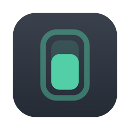
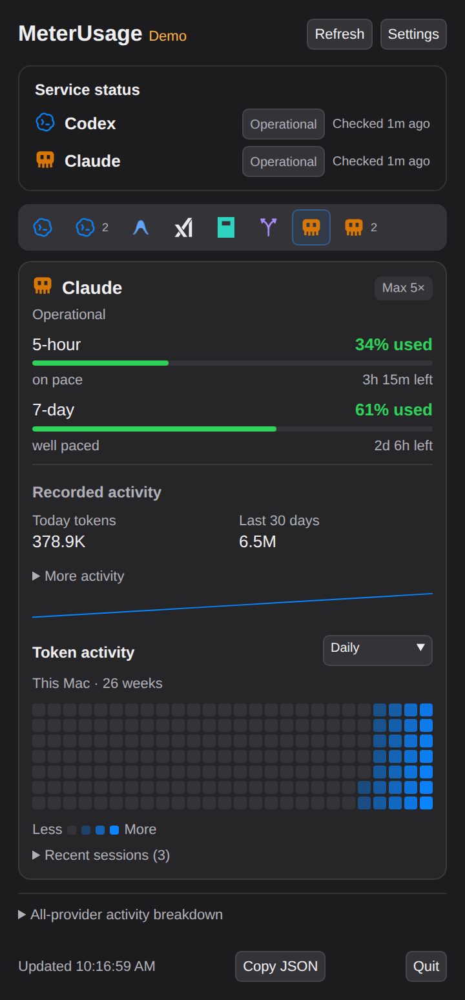
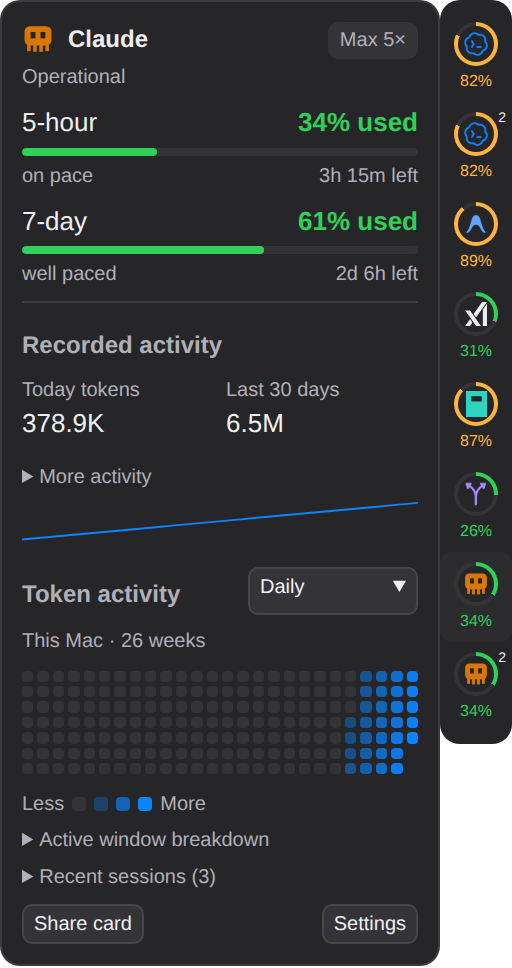

<p align="center">
  
</p>

# MeterUsage

MeterUsage monitors AI coding allowance and usage in a macOS menu bar and
floating side notch. The Electron beta is the sole offered app and default
download. Historical Swift source and releases remain available for recovery.

## Download

[Download MeterUsage 0.3.0-beta.8, build 78](https://github.com/pekth/meterusage/releases/download/v0.3.0-beta.8/MeterUsage-0.3.0-beta.8-mac-arm64.zip)
for Apple silicon, macOS 13 or later. This is a **beta**, Developer ID signed
and notarized. See [installation and known limits](docs/BETA.md).

Quit MeterUsage before replacing it and keep a recovery copy of the app and
its saved data. Beta 5 and later check hourly for newer betas or a newer stable
release when **Check for updates** is on. Beta 8 adds an update notice
in Usage and Settings > General for installation with confirmation or dismissal.
Downloads and installation show busy states; failures offer retry.

Stable acceptance remains open. Historical Swift releases and source are
[recovery references](docs/swift/README.md), with no separate offered edition.
Both implementations share app identity and saved data. Do not run them together
against a normal profile. See [versions and recovery](docs/VERSIONS.md).

## Current beta UI

<p>
  
  
</p>

Synthetic demo captures of build 61's renderer. Claude Desktop provides allowance,
not a chat-history heatmap. See the [full screenshot gallery and capture details](docs/SCREENSHOTS.md)
for Codex, Claude, side notch and Settings.

The beta includes Codex browser sign-in/account history, optional Claude Desktop
allowance, existing CLI sources, compact provider tabs and hover cards, provider
reordering and readable token totals. Account coverage depends on the source.
The beta also includes Antigravity Desktop allowance, Grok Bot Desktop (Beta),
key-free OpenCode Go local setup and separate [API billing](docs/API_USAGE_BETA.md)
under Settings → API connections. Reuse a legacy saved Admin key or enter a
one-time key. Pasted keys are not saved. OpenRouter retains its existing balance
and activity integration. Desktop compatibility and billing coverage vary;
see [known beta limits](docs/BETA.md#known-limits).

## Installation

No Node, pnpm, Swift, Xcode, Command Line Tools or Git is required to use the
prebuilt beta. Quit MeterUsage, unzip the download, drag `MeterUsage.app` to
Applications, and open it. Keep your previous app and data backup for recovery.

From a Git checkout or source archive, run:

```sh
./Scripts/make-app.sh
```

This downloads the pinned Electron beta ZIP, verifies its checksum and
signature, and prepares `dist/MeterUsage.app` with its published signature
unchanged. Drag that app to Applications to install it. Failed download,
copy or verification leaves existing generated output intact and never falls
back to compilation. Explicit `--build-from-source` remains a
[legacy Swift recovery build](docs/swift/README.md#from-a-git-checkout-no-swift).

## Setup and data coverage

All nine provider adapters remain in the retained Swift and candidate source:
Codex, Claude Code, Antigravity, OpenRouter, Grok, OpenCode Go, Cursor, Copilot
CLI and Gemini CLI. Their inputs and available measurements differ. The
[Swift provider matrix](docs/swift/README.md#provider-matrix) describes existing
CLI/local collection. The [Electron source choices](https://github.com/pekth/meterusage/blob/v0.3.0-beta.8/docs/electron/README.md#source-choices)
also describe optional Codex browser sign-in and Claude Desktop allowance.

Local activity covers this Mac. Provider-reported account data has its own
coverage limits. Missing tokens remain unknown. Local token costs are estimates; optional API
billing cards label provider-reported amounts separately. Provider dashboards
remain the billing source of record. Read the [beta privacy contract](https://github.com/pekth/meterusage/blob/v0.3.0-beta.8/docs/PRIVACY.md)
for Electron or the [retained Swift reporting privacy contract](docs/PRIVACY.md#legacy-swift-source-diagnostic-reports) before changing a
data source or sharing screenshots.

## Identity and recovery

Electron and retained Swift source use the same app name, bundle ID and default
preferences/data locations. Normal-profile side-by-side use is unsafe. Use only
[isolated candidate QA profiles](docs/electron/README.md#isolated-qa) for testing.
Historical Swift source/releases remain retrievable; recovery requires a saved
app and data backup. The distribution default does not establish stable
acceptance or verify Swift upgrade/rollback. See [ADR 0034](docs/adr/0034-electron-beta-default.md).

## Documentation

- [Beta download, verification and limits](docs/BETA.md)
- [Current beta screenshots](docs/SCREENSHOTS.md)
- [Historical Swift recovery reference](docs/swift/README.md)
- [Electron guide and known gaps](https://github.com/pekth/meterusage/blob/v0.3.0-beta.8/docs/electron/README.md)
- [Versions and staged Swift retirement](docs/VERSIONS.md)
- [Contributing](CONTRIBUTING.md)
- [Project knowledge](docs/KB.md) and [decision index](docs/adr/README.md)
- [Desktop connections](https://github.com/pekth/meterusage/blob/v0.3.0-beta.8/docs/DESKTOP-CONNECTIONS.md), [demo mode](docs/DEMO.md)
  and [side notch](docs/SIDE-NOTCH.md)
- [Concept mockups](docs/mockups/README.md) and [changelog](CHANGELOG.md)

## Compatibility links

Older root README links continue below. Detailed Swift descriptions remain in
the Swift guide; product screenshots now show the Electron beta.

<a id="choose-an-edition"></a>
See [downloads](#download).

<a id="macos-electron-migration-candidate"></a>
See the [Electron candidate guide](https://github.com/pekth/meterusage/blob/v0.3.0-beta.8/docs/electron/README.md).

<a id="second-accounts"></a>
See [Swift additional local accounts](docs/swift/README.md#second-accounts) and
[Electron advanced local accounts](https://github.com/pekth/meterusage/blob/v0.3.0-beta.8/docs/electron/README.md#advanced-local-accounts).

<a id="requirements"></a>
See [beta requirements](docs/BETA.md#install).

<a id="contributing"></a>
See [contributor setup](CONTRIBUTING.md).

<a id="agent-budget-cli"></a>
See the [Swift Agent Budget CLI](docs/swift/README.md#agent-budget-cli) and
[Electron commands](https://github.com/pekth/meterusage/blob/v0.3.0-beta.8/docs/electron/README.md#build-and-test).

<a id="showcase"></a><a id="-showcase"></a>
<a id="ambient-time-to-empty--side-notch-hud"></a>
<a id="menu-bar--popover-dashboard"></a>
<a id="settings-accounts--providers"></a>
See [current beta screenshots](docs/SCREENSHOTS.md).

<a id="provider-matrix"></a><a id="-provider-matrix"></a>
See the [Swift provider matrix](docs/swift/README.md#provider-matrix).

<a id="key-features"></a><a id="-key-features"></a>
See [Swift behavior](docs/swift/README.md#key-features).

<a id="privacy--architecture"></a><a id="-privacy--architecture"></a>
See [privacy and data handling](docs/PRIVACY.md).

<a id="download-and-installation"></a>
<a id="install-the-prebuilt-app"></a><a id="from-a-git-checkout-no-swift"></a>
See [installation](#installation).

<a id="report-a-problem"></a>
See [beta diagnostics and bug reports](docs/BETA.md#known-limits) and the
[beta reporting guide](https://github.com/pekth/meterusage/blob/v0.3.0-beta.8/docs/REPORTING.md).

<a id="-tldr"></a><a id="tldr"></a>
See [downloads](#download).

<a id="license--disclaimer"></a><a id="-license--disclaimer"></a>
## License and disclaimer

[MIT](LICENSE). Independent project, not affiliated with or endorsed by OpenAI,
Anthropic, Google, xAI, Microsoft or other providers.
