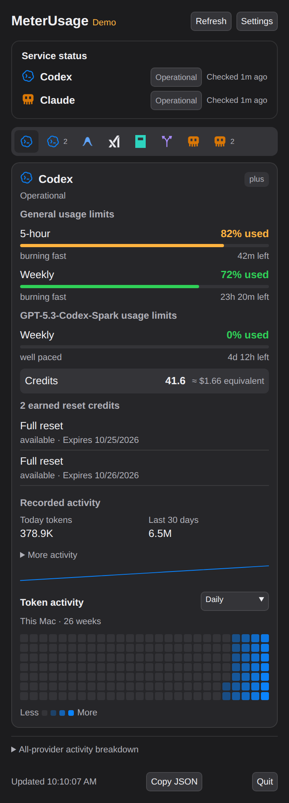
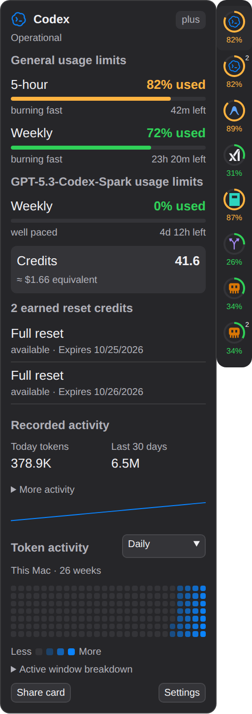
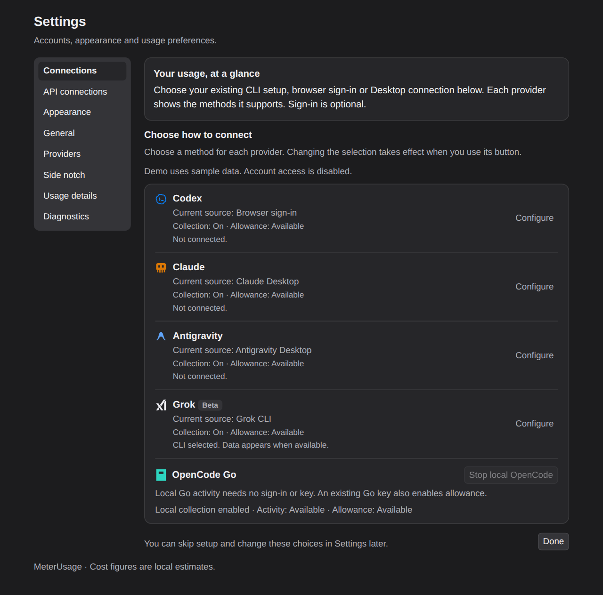
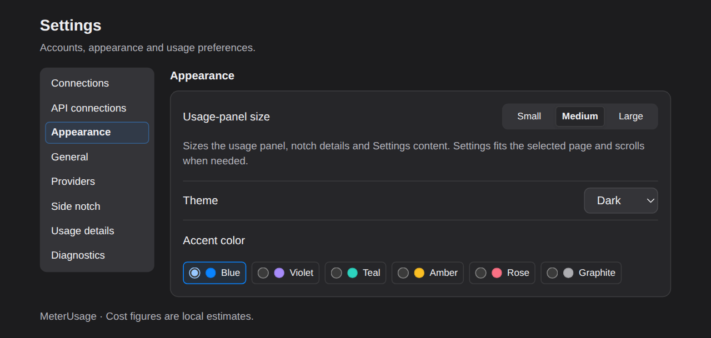
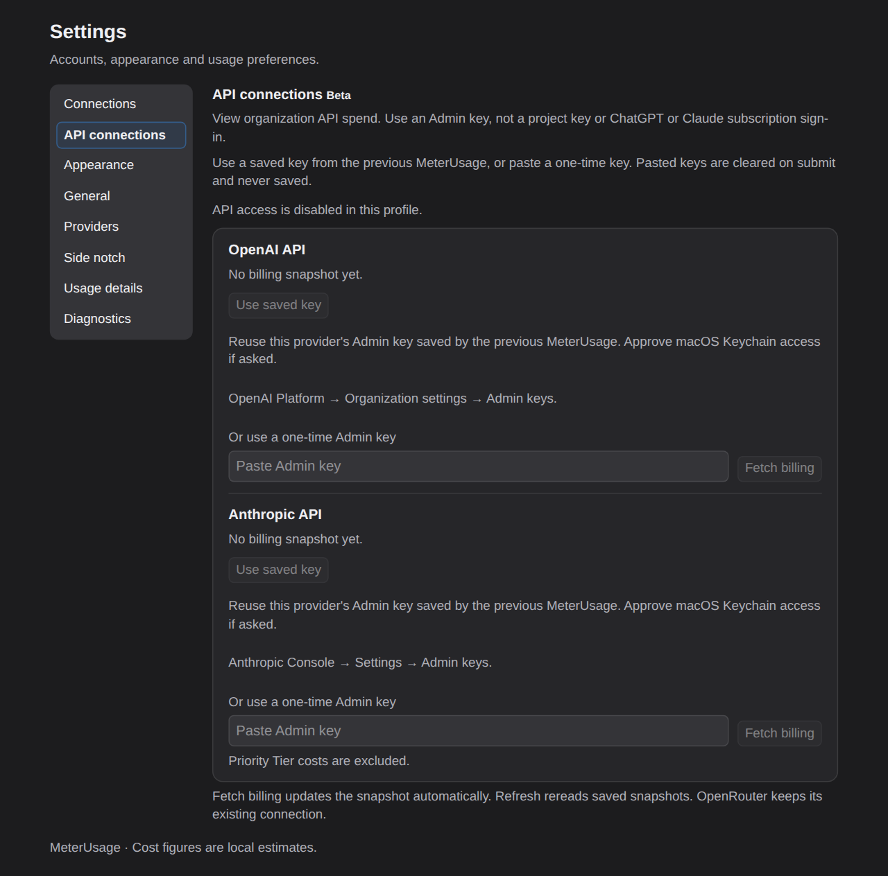
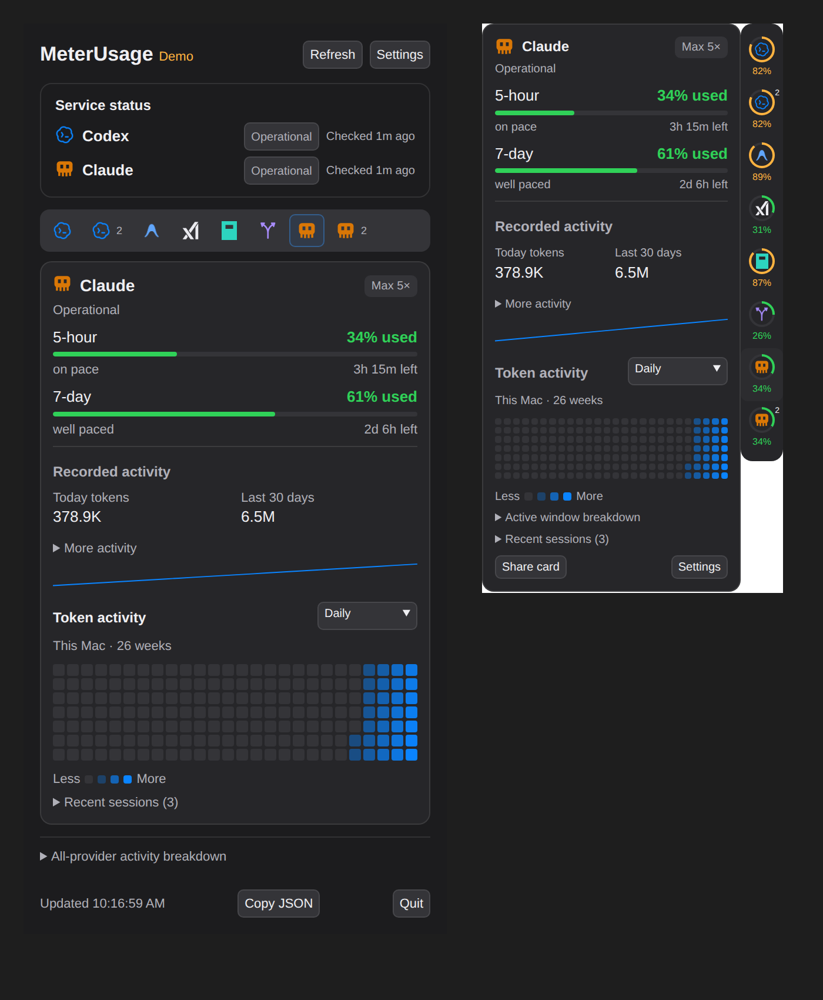

# Beta screenshots

These captures show Electron **0.3.0-beta.3, build 61** using invented demo
data. They use the release renderer at source revision
`c2d092cb92180b37a686582a904dbd0129bc371c`, captured in a browser at 2x pixel
density. The capture tool scales wide Settings images to 1280 pixels. Required generated provider marks come from the signed release bundle.
Only unused canvas below the app is cropped. The social preview combines two
current captures without changing their contents. Browser fonts and window framing
can differ from macOS; these images do not prove native behavior.

## Usage

  
  

The demo includes local token activity. Claude Desktop supplies allowance only;
its sample heatmap does not imply Desktop chat-history access. Codex browser
sign-in supplies separate provider-reported account history when available.

## Side notch

  
  

Both browser captures retain the rail at x=220, y=0, width=36 CSS pixels while
the card height changes. This checks renderer geometry, not multi-display
positioning on a Mac. Details open on hover; the rail has one design and no pin.

## Settings

API access is disabled in the synthetic demo. Source previews omit the version
footer when bundle metadata is absent; the installed app shows its bundle version.

## Sharing

Older product screenshots have been removed from the current documentation.
App icons, provider marks and the explicitly labeled historical concept mockups
remain. Git history and earlier release archives retain their original files.
